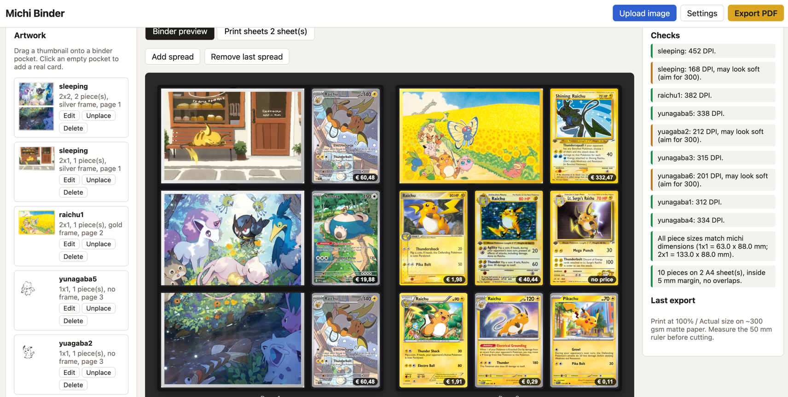

# Michi Binder

Turn your own artwork into printable inserts for a Pokemon card binder using the [Michi method](https://woahpoke.com/michi-method/#michi-method-templates).

## Getting started

Open `index.html` in your browser, no install or server needed.

## Features

- Crop artwork to span 1 to 3 pockets wide and tall, either hiding art behind pocket gaps or keeping all of it
- Choose where each artwork is cut, with pieces spanning pockets left to right
- Gold or silver card frames around the whole artwork, each piece or each pocket
- Binder preview with drag and drop placement
- Real cards in empty pockets via [TCGdex](https://tcgdex.dev) search, with optional Cardmarket prices
- Paper-saving A4 layout with exact michi dimensions (63 x 88 mm per card)
- Verified print-ready PDF export with a 50 mm calibration ruler
